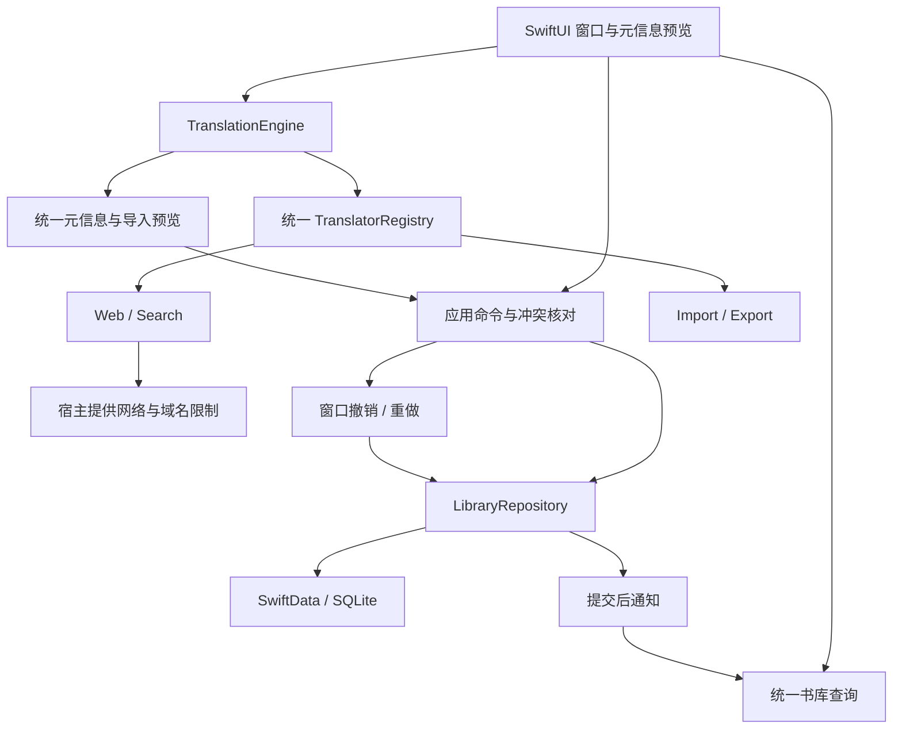

# 原生书籍管理架构

基准：2026-11-12 核对的 Zotero 官方开发文档及源码。按用户确认的范围，以书籍元信息为中心，保留 macOS 原生 SwiftUI / SwiftData 实现。

## 与 Zotero 对照

Zotero 区分窗口代码与不依赖界面的核心代码；窗口通过数据 API 调用核心。参考：[Code Architecture / JavaScript API](https://www.zotero.org/support/dev/client_coding/javascript_api)。本项目采用相同的职责划分，独立实现 Swift 代码，不复制 Zotero 的 JavaScript 或运行环境。

| Zotero 的职责 | 本应用的落点 | 已接入的行为 |
| --- | --- | --- |
| ZoteroPane / 窗口作用域 | App、Views | 每窗口独立编辑状态、选择与撤销管理器；三栏书库、书籍列表、检查器 |
| 数据对象与数据 API | Models、Domain | Book、Person/Contribution、Tag/BookTag、CollectionItem、SeriesMembership；以具体图书版本为记录单位 |
| 数据库事务与对象保存 | Persistence/LibraryDatabase、LibraryRepository | 唯一数据库写入实现；关系差异写入、提交失败回滚 |
| 核心操作与事务调用 | Application/LibraryCommands、CollectionCommands、TrashCommands、LibraryImportPlanner、BookBatchEditing | 表单保存、整理、笔记、文件夹、导入、批量修改、合并及回收站共用持久化路径 |
| Notifier | LibraryNotifier | 成功提交后按记录 ID 通知；失败不通知；查询界面观察版本变化 |
| 搜索、保存搜索 | LibraryQueries、AdvancedBookQuery、SmartCollectionService | 快速检索、标签交集、组合条件、智能文件夹、重复组与回收站范围统一组合 |
| Translate / translators | Translation/TranslatorRegistry、TranslationEngine | Web、Search、Import、Export 四类协议；同 ID 可具备多种能力，统一注册、优先级、停用和调度 |
| 翻译结果与保存分离 | 元信息预览、字段对比、LibraryImportPlan | 提取本身不写数据库；核对冲突与版本后才提交 |

Notifier 的职责参考 [官方 notifier.js](https://github.com/zotero/zotero/blob/main/chrome/content/zotero/xpcom/notifier.js)；数据对象与保存边界参考 [官方 dataObject.js](https://github.com/zotero/zotero/blob/main/chrome/content/zotero/xpcom/data/dataObject.js)。采用的是职责与行为约定，不是逐行移植或数据库格式兼容。

## 图书领域与兼容性

一本书的不同 ISBN 版本分别保存；重复检测可以识别 ISBN-10/13 等价号码，但不同有效 ISBN 的版本不能直接合并。作者、译者、编辑等贡献者保留角色和顺序；丛书与文件夹各有独立关系。标签和文件夹归属不复制图书记录；个人笔记属于本地书籍记录。阅读状态、个人评分、收藏及开始、完成阅读日期已从模型、快照、查询字段和操作入口中删除；RetiredReadingData 仅在迁移与导入边界清除旧数据，不提供旧状态、评分或收藏的匹配、编辑行为。

SwiftData 既有实体名称、UUID 和默认存储位置保持兼容。删除的阅读状态、评分、收藏、阅读日期与封面属性由推断迁移从旧表中移除；LibraryDatabase 在打开书库时清除智能查询中的状态、评分、收藏与封面条件，仅含这些旧条件的文件夹删除，混合条件保留其余规则及匹配方式。子文件夹与独立笔记升级增加可空 parentID 和 LibraryNote 实体；Book 增加可空 bookTypeRaw 与 originalLanguageCode；新建表单默认中文原版书，旧库与外部记录不推断分类。类型只控制字段显示，不删除原作信息或贡献者。JSON 备份为 schemaVersion 9，可读取版本 1/2/3/4/5/6/7/8；旧备份先清理阅读状态、评分、收藏、封面字段及规则，再通过正常校验和冲突预览。旧格式 SQLite 固定样本覆盖物理列删除、关系保留及重复迁移，备份与偏好清理由回归测试保护。Database 显式关闭自动保存，所有持久化由命令完成；打开失败显示错误，不重建或删除原书库。

BookArchive 是跨命令、预览、撤销和书目交换的值快照。编辑器打开时保存基线，保存时重新读取当前记录；发现其他窗口已修改时停止，避免旧表单覆盖新内容。笔记使用同样的规则。未变更的贡献者、标签、文件夹和丛书关系保留原关联身份。

## 窗口、书库与通知

AppState 属于单个主窗口，添加书籍快捷键路由到当前窗口。UndoManager 随窗口生存，弹窗继承父窗口的管理器；系统文本编辑撤销仍由文本框处理。

历史错误状态与 Notifier 按 ModelContext 隔离。同一个书库的窗口共享核心状态，不同书库上下文和测试容器互不影响。Notifier 只发送变更 ID；观察者可以重新执行查询，不把完整元信息或个人笔记写入事件。整批写入只在提交后通知一次；撤销和重做也走同一事务路径。

## Translator 扩展

四类能力的定义和位值参考 [Zotero translators](https://www.zotero.org/support/dev/translators)：Import 1、Export 2、Web 4、Search 8。本应用从协议实现推导能力，避免描述信息声称支持但实际未实现。

内置注册：豆瓣和 Goodreads 为 Web + Search，Open Library 为 Search，RIS 为 Import + Export，CSV 为 Export。设置中的「元信息解析器」统一显示能力并保存启停状态。停用同时影响运行入口和已缓存候选；导出格式列表从注册中心生成。

新增 Swift 适配器实现相应协议并加入 BuiltinTranslators.catalog。网络由 TranslationHost 提供，支持替换为测试客户端；适配器没有 ModelContext。普通网页继续使用受验证的 JSON 规则，按目标、优先级、检测和提取执行。文件导入返回 BibliographicImportResult，交给既有冲突预览；文件导出接收确定范围的值快照。

本项目不运行 Zotero JavaScript translator 或插件包。架构对照不代表 Zotero 文件格式、插件 API 或同步协议兼容。

## 当前边界

本应用为单个本地书库，普通文件夹支持父子层级；笔记是独立实体，可以独立存在或成为一本书的子笔记。图结构、笔记、书籍和智能规则共用事务与撤销；完整备份保留空文件夹、层级、笔记与关联。具体行为和兼容限制见 [子文件夹与笔记](ORGANIZATION.md)。普通文件夹名称仍要求全库唯一；旧版单份笔记作为书籍备注保留，可显式转为子笔记。

笔记为纯文本、显式保存。目前尚未实现富文本、相关书籍、多书库、电子书附件、阅读器、云端同步、团队库、文献引用插件或浏览器 Connector。

## 开发约束与验证

- Views 可以读取 SwiftData 的查询投影，写入必须调用应用命令；不直接 save/insert/delete/rollback。
- Domain、Application、Persistence、Translation 不导入 SwiftUI；Translation 不导入 SwiftData。
- 事务在 Repository；JSON 编解码在 BackupService；FileDocument 留在 Views。
- 源码仍编译为同一个原生应用目标，目录边界由脚本检查，并非已拆成独立二进制包。
- `python3 scripts/check-architecture.py` 检查上述关键边界与 Xcode 源文件覆盖，Release 脚本自动运行。
- `DEVELOPER_DIR=/Applications/Xcode.app/Contents/Developer swift test --scratch-path work/SwiftPMBuild` 运行回归。新增测试覆盖通知提交时序/失败无事件、书库隔离、过期表单和笔记、命令撤销、文件夹关系保留、快速查询、四类能力、停用与自定义格式派发。

封面资源实体及存储组件已删除，数据库推断迁移移除 `coverFileName`、`CoverAsset` 和关系；保留其他实体的标识与内容。`defaultLayout` 偏好随升级清理，列表为唯一布局。元信息模型、协议和网络层均不再包含图片。旧 JSON 规则在解码前忽略 `coverHosts` 和 `coverURL`，再次导出不再包含这些字段。历史独立图片文件不主动删除，也不再读取或写入。
